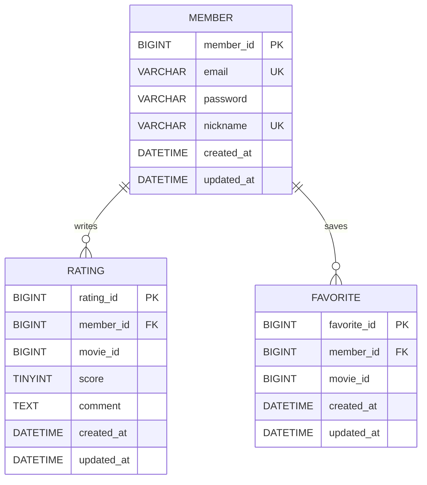

# 영화 평점 서비스 ERD

- 회원과 평점/즐겨찾기는 각각 1:N이다.
- movie_id는 TMDB 식별자를 저장하는 일반 컬럼이며 로컬 DB의 FK가 아니다.
- rating과 favorite은 각각 (member_id, movie_id) 복합 UNIQUE로 같은 회원의 같은 영화 중복을 방지한다.
- favorite은 이번 주차에 테이블만 준비하고 엔티티/API는 8주차에 구현한다.
- 비밀번호는 이번 시드에서 더미 값만 사용한다. 실제 가입 기능은 이후 주차에 해시 저장을 구현한다.
